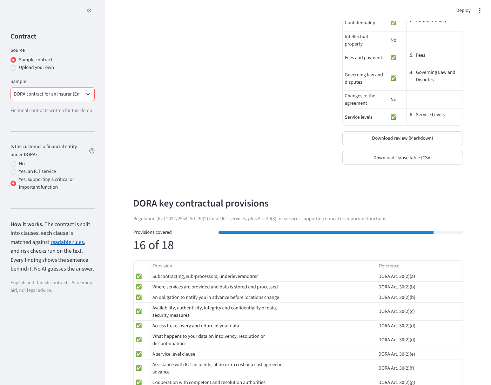
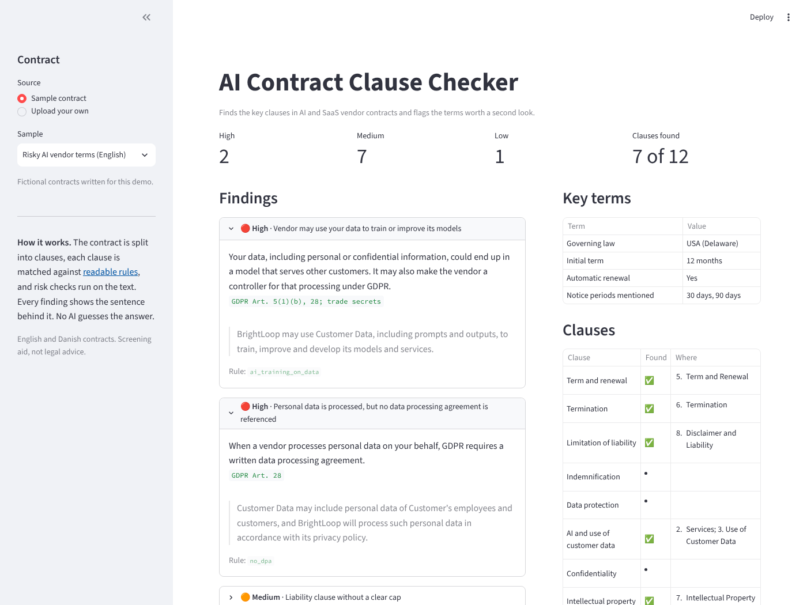

# AI Contract Clause Checker

[](https://github.com/gifmaster/contract-clause-checker/actions/workflows/tests.yml)
[](https://contract-clause-checker.streamlit.app)

**Find the key clauses in an AI or SaaS vendor contract, and the terms worth a second look.**

Upload a contract (PDF, Word or text, English or Danish). The tool splits it into clauses, pulls out the key terms, and flags risks from the customer's side, such as:

- the vendor may **train its models on your data**
- personal data is processed but **no data processing agreement** is referenced
- data may leave the EU **without safeguards**
- an AI service with **no terms supporting your EU AI Act duties**
- **automatic renewal**, **one-sided changes**, a vendor that can **end the service at any time**, **non-EU governing law**

Every finding shows the exact sentence it is based on and the rule that produced it.

**Data processing agreements:** the **GDPR pack** checks the 12 terms a data processing agreement must contain under GDPR Art. 28: processing only on your instructions, staff confidentiality, security, sub-processor approval and flow-down, help with data subject requests and impact assessments, breach notification, deletion or return, audits, and a warning about unlawful instructions. It switches on when a document mentions personal data. Run it on the DPA itself: when a contract points to a DPA in an appendix, the tool says so and asks for the DPA instead of reporting ten gaps.

**For NIS2 entities:** the **NIS2 pack** checks the supplier contract terms behind NIS2 supply chain security (Art. 21(2)(d)), using the eight points in 5.1.4 of the Annex to Implementing Regulation (EU) 2024/2690: security requirements, staff training, background checks, incident notification, audits, vulnerability handling, subcontracting and exit. That list is binding for digital infrastructure and ICT service providers, and the most concrete guide for every other NIS2 entity.

**For banks, insurers and pension funds:** switch on the **DORA pack** to check the contract against the key contractual provisions in DORA Art. 30. Every AI tool a financial entity buys is an ICT service, so its contract must contain them. You get a checklist of all 12 provisions for any ICT service, or 18 for services supporting a critical or important function.





**[Try it live](https://contract-clause-checker.streamlit.app)** with seven fictional samples, including a contract for an insurer under DORA, one for a water utility under NIS2, and an English and a Danish data processing agreement.

## Why rules, not an LLM

Same reason as the [EU AI Act Risk Check](https://github.com/gifmaster/ai-act-risk-check): a review tool should be able to show its work.

- Clause types and checks live in readable YAML files: [`clauses.yaml`](src/clausecheck/rules/clauses.yaml), [`checks.yaml`](src/clausecheck/rules/checks.yaml) and the packs [`gdpr.yaml`](src/clausecheck/rules/gdpr.yaml), [`nis2.yaml`](src/clausecheck/rules/nis2.yaml) and [`dora.yaml`](src/clausecheck/rules/dora.yaml)
- Every finding cites the sentence behind it
- Negations are handled: *"shall not use Customer Data to train"* is not flagged, *"may use Customer Data to train"* is
- Accuracy is measured against hand-labelled contracts and enforced in CI

A check looks like this:

```yaml
- id: no_dpa
  severity: high
  title: Personal data is processed, but no data processing agreement is referenced
  type: requires
  if_any: ['personal data', 'personoplysninger', ...]
  then_any: ['data processing (agreement|addendum)', 'article 28', 'databehandleraftale', ...]
  ref: GDPR Art. 28
```

## Accuracy, honestly

| Set | Clause detection | Checks (precision / recall) |
|---|---|---|
| Development samples (EN and DA) | 26 of 26 | 1.00 / 1.00 |
| Held-out contract, **first run** | 0 of 6 | 0.50 / 1.00 |
| Held-out contract, after two general fixes | 6 of 6 | 1.00 / 1.00 |
| DORA pack, development samples | 41 of 41 | 1.00 / 1.00 |
| Held-out Danish DORA contract, **first run** | 7 of 8 | 0.57 / 1.00 |
| Held-out Danish DORA contract, after three general fixes | 8 of 8 | 1.00 / 1.00 |
| GDPR pack, 8 development documents (6 contracts, 2 DPAs) | n/a | 1.00 / 1.00 |
| Held-out DPA in a different drafting style, **first run** | n/a | 1.00 / 1.00 |
| NIS2 pack, 7 development contracts | n/a | 1.00 / 1.00 |
| Held-out Danish NIS2 contract, **first run** | n/a | 1.00 / 1.00, one of them by luck (see below) |
| **Public contracts the author did not write** (6 real, 1 synthetic), **first run** | 13 of 25 | **0.21 / 0.43** |
| Same documents, after seven general fixes (tuned on these, so not independent) | 25 of 25 | 1.00 / 0.93 |
| Two further public contracts, labelled first, **first run** | 11 of 11 | **0.83 / 0.83** |
| Same two, after three more fixes (no longer independent) | 11 of 11 | 1.00 / 1.00 |

The last four rows come from real, openly licensed contracts from Common Paper, Bonterms and GitHub. The tool did far worse on them than on its own samples,
which is the point of testing on them. What went wrong, what was fixed and what is still wrong: [docs/REAL-WORLD-TEST.md](docs/REAL-WORLD-TEST.md).

The NIS2 held-out contract also scored 1.00 on its first run, but a unit test then showed that one result was luck: the rule did not understand the Danish compound *sikkerhedshændelse*, and only matched because the heading *Hændelser* sat next to *uden unødig forsinkelse*. Danish compounds are now matched by their last part. The GDPR held-out DPA passed on its first run, including a planted trap (breaches "handled as set out in Annex II" with no duty to tell you). It was written by the same author as the rules, so it is a weaker test than a real contract. Each earlier held-out test found real weaknesses: a heading style the rules did not know, and short numbered sub-clauses that were read as headings and never checked. They were fixed in general terms and are now regression tests. Small fictional test set, so treat the numbers as a floor for known patterns, not a promise for every contract. Details in [docs/METHOD.md](docs/METHOD.md).

## Run it locally

Recommended for real contracts, so they never leave your machine.

```bash
git clone https://github.com/gifmaster/contract-clause-checker.git
cd contract-clause-checker
pip install -r requirements.txt
streamlit run app.py
```

From Python:

```python
from clausecheck import Rules, analyse, read_file

result = analyse(read_file("contract.pdf"))
for f in result.findings:
    print(f.severity, f.title, f.evidence[:1])
print(result.values)   # governing law, notice periods, liability cap, ...

# DORA: "all" for any ICT service (Art. 30(2)), "critical" adds Art. 30(3)
result = analyse(read_file("contract.pdf"), dora="critical")
for check, covered in result.dora_checklist(Rules.builtin()):
    print("covered" if covered else "NOT FOUND", check["ref"], check["looked_for"])

# NIS2 supply chain terms (Art. 21(2)(d), Impl. Reg. (EU) 2024/2690 Annex 5.1.4)
result = analyse(read_file("contract.pdf"), nis2=True)
for check, covered in result.nis2_checklist(Rules.builtin()):
    print("covered" if covered else "NOT FOUND", check["ref"], check["looked_for"])

# GDPR Art. 28: the terms a data processing agreement must contain
result = analyse(read_file("dpa.pdf"), gdpr=True)
print(result.dpa_elsewhere)   # True when the document points to a DPA kept in another document
for check, covered in result.gdpr_checklist(Rules.builtin()):
    print("covered" if covered else "NOT FOUND", check["ref"], check["looked_for"])
```

## Tests

```bash
pip install pytest
pytest
```

144 tests: segmentation, negation and consent handling, rule validation, the GDPR, NIS2 and DORA packs, accuracy against labelled contracts, identical results from PDF, Word and text, and app smoke tests.

## Part of a toolkit

| | |
|---|---|
| [EU AI Act Risk Check](https://github.com/gifmaster/ai-act-risk-check) | Classify an AI system under the EU AI Act |
| [Practical AI Governance Framework](https://github.com/gifmaster/ai-governance-framework) | Policy, roles, lifecycle and templates |
| This tool | Review the vendor contract before you buy |
| [AI Use Case Register](https://github.com/gifmaster/ai-use-case-register) | Keep track of every AI use case |
| [Regulation Navigator](https://github.com/gifmaster/regulation-navigator) | See which of the AI Act, GDPR, NIS2 and DORA apply, and where they overlap |

## Limitations

A screening aid for contract review, not legal advice. It needs headings to split clauses, does not read appendices, and covers the customer's side of AI and SaaS contracts. The GDPR, NIS2 and DORA packs check that a term is there, not that it is good enough. See [docs/METHOD.md](docs/METHOD.md).

## About

Built by **Alexander Senderovitz**, AI governance and digital transformation, Copenhagen.
[senderovitz.eu](https://senderovitz.eu) · [alexander@senderovitz.eu](mailto:alexander@senderovitz.eu)

Licensed under the [GNU AGPL-3.0](LICENSE): free to use, study and change. If you run a modified version as a service, you must share its source code. Commercial license without these terms: [alexander@senderovitz.eu](mailto:alexander@senderovitz.eu).
